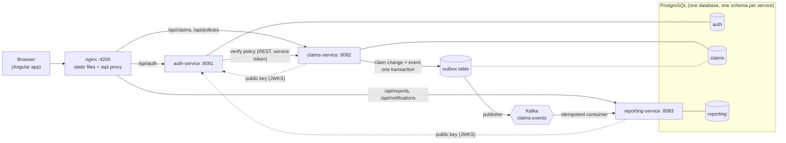

# Claims Platform

An insurance claims platform for six Southeast Asian markets. **Claimants** report incidents against
their policies and follow their claims; **claims officers** pick claims up, ask for information,
set a reserve and settle or reject them; **managers** see team workload and the company's liability
exposure per currency. Built as three Spring Boot services, Kafka, PostgreSQL and an Angular frontend.

All names, policies and accounts are fictional demo data.

## Quick start

You need only **Docker** (Docker Desktop or Docker Engine with Compose v2). No Java, Maven or Node.

```bash
git clone <this repo>
cd claims-platform
docker compose up --build
```

Open **http://localhost:4200** once the `frontend` container has started (compose waits until the
three services report healthy). The first build downloads base images and all Maven/npm dependencies
took about **3 minutes** on my machine with the base images already downloaded (allow 5–10 minutes
on a first run, depending on your connection); later starts take seconds.

Also reachable: Swagger UIs on `http://localhost:8081/swagger-ui.html` (auth), `:8082` (claims),
`:8083` (reporting).

Stop with `Ctrl+C`; `docker compose down -v` also deletes the data (database, Kafka, uploads, signing key).

## Demo accounts

Demo-only credentials, seeded into the local database.

| Role | Email | Password |
|---|---|---|
| Manager (all markets) | `manager@example.com` | `Manager123!` |
| Officer, two per market | `officer.<market><n>@example.com`, market = `my sg th id ph vn`, n = `1 2` (e.g. `officer.my1@example.com`) | `Officer123!` |
| Claimant | `claimant1@example.com` (MY, SG, TH policies), `claimant2@example.com` (ID, PH, VN policies) | `Claimant123!` |

**Trying registration:** only existing policyholders can register, with their policy number and the
email on the policy. These policies have no account yet:

| Policy number | Email to register with | Note |
|---|---|---|
| `POL-MY-PRP-0007` | `holder3@example.com` | works |
| `POL-SG-MTR-0008` | `holder4@example.com` | works |
| `POL-TH-PRP-0009` | `holder5@example.com` | works |
| `POL-VN-MTR-0010` | `holder6@example.com` | cancelled policy: refused with the same message as a wrong number or email |

Policy cover periods are relative to the day the database was created, so the demo data never expires.
The full list of seeded policies is in
`services/claims-service/src/main/resources/db/migration/V3__seed_policies.sql`.

## 5-minute demo

Each browser tab keeps its own login, so you can have the claimant, officer and manager open side by side.

1. **Claimant reports an incident.** Log in as `claimant1@example.com` → *Report an incident* → pick
   policy `POL-MY-MTR-0001` (Malaysia, motor), a date in the last few days, an amount, a location,
   a description, and attach a JPEG or PNG photo → *Submit claim*. The claim opens with its timeline.
2. **MY officer picks it up.** In a new tab log in as `officer.my1@example.com`. You land on the
   *Queue* (oldest first). Click *Pick up* on the new claim → it opens with the actions the claim's
   status allows. Click the eye icon on the photo to preview it. Click *Request information* and ask
   for a repair quote.
3. **Claimant answers.** Back in the claimant tab, within 15 seconds the bell shows a notification.
   Click it → the claim opens with an *Action needed* card. Type an answer, attach a PDF, *Send response*.
4. **Officer assesses and settles.** The officer's bell shows "The claimant has responded". Open it →
   *Assess*: the dialog shows the sum insured and refuses a reserve above it. Enter a reserve, save.
5. **Manager sees the exposure.** In a third tab log in as `manager@example.com`. The *Dashboard*
   shows the reserve in the **MYR** card ("N claims reserved"). Now *Settle* the claim as the officer
   (green button) and reload the dashboard: the reserve leaves MYR exposure. The claim shows as
   *Settled* in *All claims*; *Team performance* counts it.
6. **Markets are separated.** Log in as `officer.sg1@example.com`: the MY claim is in neither the
   queue nor *My claims*, and opening its URL directly gives "Claim not found".

**Kafka resilience check.** The dashboards are fed by events through Kafka; claims don't depend on it.

```bash
docker compose stop kafka
```

Now assess or settle a claim as an officer: it still works (the change and its event are saved
together in claims-service's outbox). The manager dashboard doesn't change, and its
"Includes changes up to …" time stays old. Then:

```bash
docker compose start kafka
```

Within a few seconds the outbox publisher sends the waiting events, reporting catches up, and the
dashboard shows the change after a reload.

## Architecture



**Why three services.** *auth* owns accounts and signs tokens; *claims* owns policies, claims, the
state machine and documents; *reporting* owns the read model for dashboards and notifications. They
change for different reasons and have different load: dashboards can be slow or down without
stopping anyone from working on a claim.

**REST vs Kafka.** Everything a user waits for is REST: logging in, opening a claim, an officer's
action (the officer must hear "someone else already picked this up" at once). Reporting doesn't
answer anyone, so it learns about claim changes asynchronously through Kafka and may be a few seconds
behind; every dashboard says how fresh it is ("Includes changes up to …").

**Outbox and idempotent consumer.** claims-service writes the claim change, its history row and the
event into its own database **in one transaction**, and a publisher sends pending events to Kafka.
So there is never a change without an event or an event without a change, and Kafka being down only
delays reporting. Kafka may deliver an event twice; reporting records processed event ids and each
event carries the claim's version, so a duplicate or an older event never counts twice.

**Schema per service.** One PostgreSQL instance, but each service has its own schema and its own
database user, which cannot read the other schemas. Services share data only through APIs and events,
never through tables.

**Authentication (RS256 + JWKS).** auth-service signs JWTs with an RSA private key and publishes the
public key at `/.well-known/jwks.json`. The other services fetch it on first use and verify tokens
locally, so they can check tokens but never create them, and auth-service isn't on every request's
path. For registration, auth-service asks claims-service whether the policy number and email match,
using a one-minute token it signs for itself.

More detail: [docs/DESIGN.md](docs/DESIGN.md) and [docs/DECISIONS.md](docs/DECISIONS.md).

## Repo layout

| Folder | What's in it |
|---|---|
| `services/auth-service` | registration, login, JWT signing, JWKS endpoint, seeded staff accounts |
| `services/claims-service` | policies, claims, state machine, information requests, documents, outbox publisher |
| `services/reporting-service` | Kafka consumer, dashboard read model, reports API, notifications |
| `libs/claims-events` | the event classes shared by producer and consumer (the Kafka contract) |
| `libs/web-common` | shared security setup, ProblemDetail errors, health endpoint, OpenAPI rules |
| `frontend` | Angular app, its nginx config and the committed OpenAPI specs (see [frontend/README.md](frontend/README.md)) |
| `infra/postgres` | database init script: one schema and one user per service |
| `docs` | design, decisions, frontend design system, AI briefs |
| `docker-compose.yml` | the whole platform, or just the infrastructure for development |

## Running the tests

| What | Command | Needs | Tests |
|---|---|---|---|
| Backend | `./mvnw clean verify` (Windows: `mvnw.cmd clean verify`) | JDK 25 and Docker (Testcontainers starts real PostgreSQL and Kafka) | 89 |
| Frontend | `cd frontend && npm ci && npm test` | Node 24+ | 23 |

The backend tests cover every allowed and forbidden state transition, permission checks (other
claimant's claim, other market, not assigned), the outbox writing change and event together, the
consumer handling the same event twice, concurrent pick-up (one gets 409) and file upload checks.

## Development mode

Run only the infrastructure in Docker, and the services and frontend on your machine (hot reload):

```bash
docker compose up -d postgres kafka kafka-init     # Postgres on :5433, Kafka on :9092
./mvnw install -DskipTests                          # once, so the services find libs/*
./mvnw -pl services/auth-service spring-boot:run       # :8081
./mvnw -pl services/claims-service spring-boot:run     # :8082
./mvnw -pl services/reporting-service spring-boot:run  # :8083
cd frontend && npm install && npm start             # http://localhost:4200, proxies /api to the services
```

Don't run the full compose stack at the same time: both use ports 8081–8083 and 4200. In development,
auth-service keeps its signing key in `~/.claims-platform/auth-jwt-key.pem` and uploads go to `./data/`
(both git-ignored).

## Documentation

| Document | What it covers |
|---|---|
| [docs/DESIGN.md](docs/DESIGN.md) | architecture, data model, state machine, events, API, all resolved questions |
| [docs/DECISIONS.md](docs/DECISIONS.md) | the key decisions with their trade-offs, known limitations, next steps |
| [docs/FRONTEND-DESIGN.md](docs/FRONTEND-DESIGN.md) | the visual design system |
| [frontend/README.md](frontend/README.md) | how the Angular app is organised, request flow, styling, generated client |
| [AI_JOURNAL.md](AI_JOURNAL.md) | how AI tools were used during the build |
| [docs/ai-briefs/](docs/ai-briefs/) | the briefs given to the AI coding assistant, step by step |

## Known limitations and what I'd do next

Built under a time limit; these are conscious gaps, explained in [docs/DECISIONS.md](docs/DECISIONS.md#known-limitations):

- One outbox publisher instance (strict per-claim ordering); several instances would need partition-aware locking.
- Uploads on local disk (Docker volume); a crash between saving a file and its database row can leave an orphan file.
- The token sits in sessionStorage (readable by scripts if there were an XSS bug); an httpOnly cookie is the production choice.
- Notifications are polled every 15 s, not pushed. No refresh tokens or password reset. No rate limiting on login/register.
- Policies are seeded reference data, not integrated with a policy system. Exposure is per currency, never converted.
- "Today" for policy cover is the database date in UTC.

Next: server push for notifications, object storage for documents, refresh tokens with httpOnly
cookies, rate limiting, a CI pipeline running both test suites and the compose build, and tracing
across the services.
